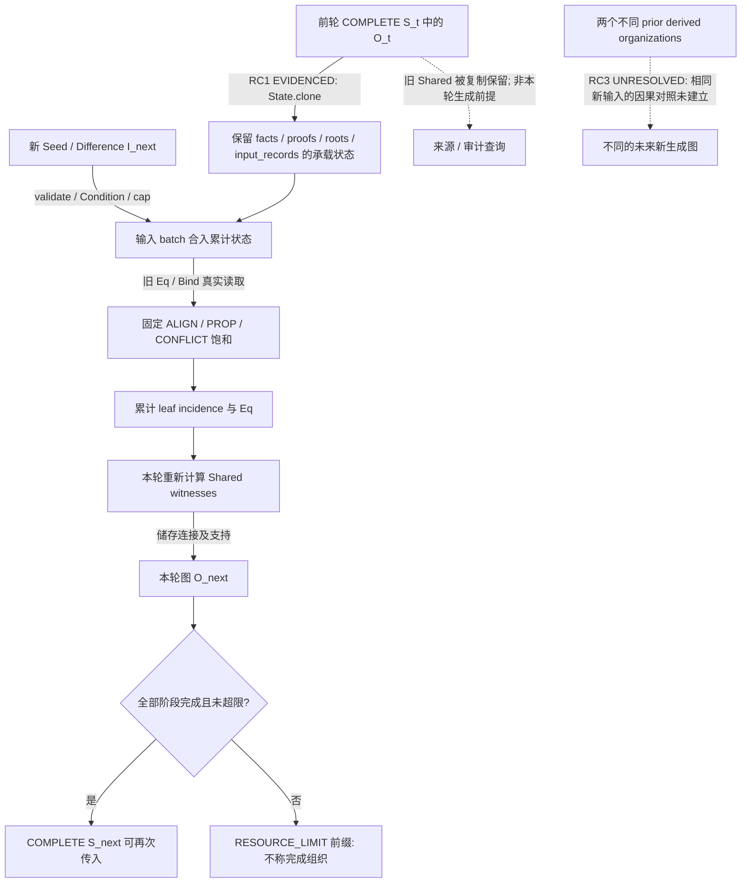

# GSC-0 Recursive Continuity Audit

日期：2026-10-05。源码读取基线：`653296a3672c6657c30a6e446b4a27f0bd75e89f`。

被审对象固定为 [scope audit §3.3](CURRENT_ORGANIZATION_SCOPE_AUDIT.md#33-o-g0-1) 的 **O-G0-1：derived structural graph，Eq/Bind/PortBind/Conflict/Shared-incidence**。不重判 CO-WAC-1 的 C1—C5，不把 Composite 的成员、组织性或消费者当成本对象的性质。

本轮只新增本文，不修改三个已有组织审计/标准文件、代码、测试、原型、历史数据或理论仓库；不运行新测试、closure、A 或 Minecraft。读取 JSON 与测试源码不是重跑。既有执行计数和具体结果用于限定证据，不继承其总体验收标签。

## 1. 状态与裁定口径

记 `S_t` 为前轮 Result.state，`O_t` 为其中本对象的图投影。S_t 还携带 declarations、输入 Relation/Change、来源及其他结构；`Engine.run` 接收的是 **完整 State，不是孤立图投影**。本轮追踪 O_t 在这个承载状态中的保留和计算作用，不声称图投影独自包含所有运行输入。

实际接口为 `Engine(condition).run(seeds=I, previous=S_t)`；若返回 COMPLETE，才把结果图称为本轮完成的 O_(t+1)。`Result.closure_complete` 的来源是 status，不是任何非空 state。RESOURCE_LIMIT 返回的阶段前缀不得占用 COMPLETE 的位置。

| 裁定 | 本轮含义 |
|---|---|
| EVIDENCED | 限定能力有实际源码路径及匹配的既有测试/记录；不扩大到未测试范围 |
| PARTIAL | 有已证明子能力，但整项范围中的部分类型/语义/证据不足或缺失；分开列出 |
| ABSENT | 现有实现没有该能力边或明确不进行该操作；不是单因缺测试 |
| UNRESOLVED | 所要求证据尚未建立，不能仅靠静态可行性判断实际已经验证 |

以下六项分别列 code path、existing evidence、static inference、limitation、verdict。它们与 CO-WAC-1 分数不是同一量表。

## 2. RC1 — Persistence

### Code path

- [Engine.run:320—324](experimental/gsc0/engine.py#L320)：重置的是 operations/rounds；状态由 `previous.clone()` 获取，有 previous 时不从空 State 开始。
- [State.clone:53—55](experimental/gsc0/engine.py#L53)：复制 facts 字典、每个 proofs 支持集合、roots 集合和 input_records 集合；condition 与 composition 对象引用沿用。
- 输入及各阶段先在 batch clone 上更新，再提交 state（[350](experimental/gsc0/engine.py#L350)、[369](experimental/gsc0/engine.py#L369)、[382](experimental/gsc0/engine.py#L382)）。facts/proofs 不因新一轮清空；同 key 同内容可再出现并增加支持。
- composition 在 clone 时沿用旧索引，但后续完成阶段构造新索引（[426](experimental/gsc0/engine.py#L426)、[429](experimental/gsc0/engine.py#L429)）。这是状态承载说明，不将 Composite 的性质归给 O_t。

### Existing test/report evidence

- [tests.py:25—35](experimental/gsc0/tests.py#L25)：先 `run(history)`，再 `run(delta,previous=initial.state)`；明确检查两轮 COMPLETE。
- [test_idempotence:63](experimental/gsc0/tests.py#L63) 将已完成结果再次作为 previous 输入。`same_closure`（[16](experimental/gsc0/tests.py#L16)）逐项比较 facts/proofs/roots/input_records 和索引的 leaves/masks/index，不只比较 hash。
- [test_input_monotonicity_and_cumulative_envelope:249](experimental/gsc0/tests.py#L249) 断言初始 facts keys 是下一轮的子集。
- [test_resource_limit_preserves_history:103](experimental/gsc0/tests.py#L103) 在增量失败时核对旧对象 digest 未变，并检查返回事实/支持保持旧历史。
- [validate.py:30—32](experimental/gsc0/validate.py#L30) 实际用新 Engine 对旧 state 接入 delta。既有 `GSC0_PROTOTYPE_VALIDATION.json` 记录 23 项执行、core_fixture.status=COMPLETE；这是该两轮 fixture 的记录，不是无限运行记录。

### What is only statically inferable

facts 中的 typed records 是 frozen dataclasses，clone 复制可变容器而共享记录引用；Engine 自己没有修改旧 composition 索引的路径。`CompositionIndex` 本身不是 frozen，不能把当前受控 run 的保留保证扩大成“调用者任意修改索引也安全”。没有逐字段 alias/mutation 专项测试。

### Exact limitation

这是内存中的 COMPLETE 状态传递，不是 SQLite 持久化、跨崩溃恢复或主体连续性的证明。`previous` 参数只接受 State 内容，不携带 Result.status；run 不检查前轮是否 COMPLETE。正确使用的 fixture 显式检查了 COMPLETE，但接口本身也可能收到不完整 state，不能自动宣称那条链完整。Condition 必须相等，新增输入仍受累计 cap 限制。

**Verdict：EVIDENCED — 同一 Condition 下，已完成 state 的受控内存保留及再传入。**

## 3. RC2 — Re-entry

### Code path

[consequences:282—318](experimental/gsc0/engine.py#L282) 从承载旧 state 的 facts 实际提取 Eq、Binding、Relation/Node，并逐条执行规则；不是仅在 clone 中保存它们。后续 shared-incidence 扫描 leaf incidence/eqs；关键区别如下。

| 前轮类型 | 下一轮实际计算消费者 | 跨轮证据与限制 |
|---|---|---|
| Eq | ALIGN-SYM/TRANS、PROP-ALIAS；shared 段查 exact Eq key | previous 路径和 idempotence 确实再次执行这些规则；没有逐条 trace 区分旧派生 Eq 与本轮重产生的同 key Eq |
| Bind | PROP-ALIAS、PROP-PORT、CONFLICT | 从累计 facts 建 bindings 列表，实际读取 variable/value；重复 COMPLETE 与增量 fixture 使用这条路径 |
| PortBind | `incidence` 读取其 variable→本轮 Shared 构建 | 不进入 basic rules 的 Binding 列表。旧 canonical 内容保留，且同 key 可能先由原支持重新生成；缺少“单独保留前轮 PortBind 即驱动新结构”的既有跨轮隔离证据 |
| Conflict | `incidence` 读取其 variable→本轮 Shared 构建 | 不作为别名/选值规则前提。既有 conflict 测试是单次 run，不是带新输入的前轮 Conflict 消费对照 |
| Shared | **旧 Shared 不直接作为下一轮 adjacency 的输入**；新 shared 段重建 witnesses，再消费它们 | 旧记录/支持仍在 facts/proofs，可被 provenance/query 读取；这与下一轮生成计算消费旧 Shared 不同 |

PortBind/Conflict 的 incidence 路径见 [model.py:203—213](experimental/gsc0/model.py#L203)。Shared 的区别来自 [engine.py:377—398](experimental/gsc0/engine.py#L377)：`LEAF_TYPES` 不含 Witness，`witnesses={}` 新建，然后由累计 leaves/eqs 重新推导；adjacency 读取的是这个本轮字典，而不是前轮 `state.composition.index` 或 facts 中旧 Shared 的端点。basic consequences 也不取 Witness。

### Existing test/report evidence

- `test_idempotence` 把包含前轮 Eq/Bind/PortBind/Shared 的完整结果再次传入，比较重复结果和支持；说明旧 COMPLETE state 实际再进入执行路径。
- [test_all_immediate_basic_rule_supports:141](experimental/gsc0/tests.py#L141) 对已派生图重新运行 consequences 枚举，核对适用的事实和支持；是消费者证据，**不是新的下一轮输入实验**。
- [test_conflict_preservation:67](experimental/gsc0/tests.py#L67) 核对 Conflict 及其组合侧用途，但其一次性输入不能升级成前轮 Conflict→下一轮新图的验证。
- [test_flatten_and_shared_witness_completeness:199](experimental/gsc0/tests.py#L199) 和 Shared 支持记录验证现轮共享图内容，不验证旧 Shared 被下一轮独立采用。

### What is only statically inferable

旧 canonical PortBind/Conflict 在累计 leaf 图中可参与 incidence。它们可能在 basic saturation 时先被原有 Bind 再产生为同 key；没有观察计数器可以据现有记录确认读取的是哪一轮 Python 对象。逻辑内容连续与对象引用同一是不同命题。旧 proofs 在 root_witnesses 查询中被读取属于来源计算，不能替代生成消费者。

### Exact limitation

至少 Eq/Bind 有实际跨轮重新计算路径；不是五种结构都“保存了所以必定重新驱动生成”。Shared 的**逻辑图可重建**，不等于旧 Shared 本身存在直接生成反馈边。没有要求一切 primitive 都必须拥有独立新规则；只如实记录这个对象各部分的消费范围。

**Verdict：PARTIAL — Eq/Bind 再进入计算有证据；PortBind/Conflict 的跨轮独立消费证据有限；旧 Shared→下一轮生成的直接边 ABSENT。**

## 4. RC3 — History-conditioned future generation

### Code path

[run:322](experimental/gsc0/engine.py#L322) 保留 prior facts；[consequences:282](experimental/gsc0/engine.py#L282) 在累计状态上饱和。旧 Binding 与新 Equality、或旧 Eq 与新 Binding 在语法上可以共同作为 PROP-ALIAS 支持。代码允许 history-conditioned generation 的路径，但“允许”不是所要求反事实的执行记录。

### Existing test/report evidence

| 现成证据 | 实际控制/比较什么 | 为什么不直接满足本项 |
|---|---|---|
| GSC-0 history ablation（[tests.py:39](experimental/gsc0/tests.py#L39)） | 删除 seed R2，独立 `run(h+d)`，比较指定结果 | 未将两个既成派生 O_t 作为 previous，在相同未来输入下比较；主要是输入材料消融 |
| GSC-0 difference ablation（[45](experimental/gsc0/tests.py#L45)） | 去 D1/D2 | 当前输入不同，不是 identical I_(t+1) |
| GSC-0 order/idempotence | 相同 seeds 换顺序、相同 previous 无新输入 | 检查不变性，不是不同 prior organization 导致不同未来生成 |
| same_fact_new_source（[256](experimental/gsc0/tests.py#L256)） | 同一事实增加来源，facts 不变、根增加 | 是来源累积，不是不同组织内容改变后续生成 |
| GSC-1 paired-history（[tests.py:47](experimental/gsc1/tests.py#L47)） | 独立输入 H_i=Bind(h_i,v_i) 的值不同，相同 explicit Eq 当前输入，产生不同对应 bindings/tuple | 确有历史数据条件化的近邻证据，但变化源是显式历史 seed binding 值；没有隔离并追踪 prior **derived organization** 差异对未来图生成的独立作用，最终 tuple 也不是本 O |

为避免遗漏，读取了 GSC-1 的既有调用：`close_history` 确实先形成 initial，再 `run(current,previous=initial.state)`（[fixtures.py:34](experimental/gsc1/fixtures.py#L34)）；JSON 的 `history_changed_records=[0,2]`，`cases.A.history[0].rule=INPUT`，shared_current_input 是三个固定 Eq。这个历史对照不能被说成不存在，但也不能把显式输入值的作用直接改称“前轮生成的组织关系的作用”。本节不重新审计 GSC-1 组织评分或行为作者权。

### What is only statically inferable

不同 prior states 的有效事实/约束可能影响新饱和内容。已有源码可以定位潜在 join；本轮没有执行它，也没有现成隔离对照把下一轮差异归因于前轮派生组织，而不是输入值、来源记录、保留旧事实本身或输出包装差异。

### Exact limitation

目前没有本对象范围内已核对的 `O_t^A != O_t^B`、相同未来 I、由 prior derived organization 因果引起不同**新生成** O_(t+1) 的完整对照。只比较两个最终累计图不同也不够：它们可能只是分别保留不同旧输入。不能以“源码应该如此”、既有 root 消融或 tuple 变化补齐该证据。

**Verdict：UNRESOLVED — 已定义的 history-conditioned future-generation 因果边尚未在严格本对象范围验证；不是该边实现不可能或一定缺失。**

## 5. RC4 — Incremental reality coupling

### Code path

- [model.py:175—200](experimental/gsc0/model.py#L175) `difference(before,after)` 把新增/变化的可表达事实转为 Seed，同时保留 Change notice 与来源；输入事实本身不由 closure 猜测。
- [run:350—363](experimental/gsc0/engine.py#L350) 将新 seeds 合入 previous.clone 的 batch，更新 roots/proofs/input_records，随后以累计 facts 饱和。
- 若本轮 COMPLETE，其新 Eq/Bind/PortBind/Conflict/Shared 图与旧事实/支持共存。没有清空事实、重新只用当前 observations 建独立 State 的步骤。

### Existing test/report evidence

- 标准 fixture 两轮：R1/R2/R3 历史 closure→D1/D2 Difference。`setUpClass`、`validate.py:30—32` 均实际传 previous；既有 core_fixture.status=COMPLETE。
- 旧 declarations 已产生 Eq(B,B) 等关系，新 Eq(Y,X)/Bind(Y,3) 加入后进入累计传播/共享计算；生成 Bind(X,3)、相应 PortBind/Shared 的源码及 basic saturation 断言可核对。无需把 R4 的 Composite novelty 转移过来。
- [test_input_monotonicity_and_cumulative_envelope:249](experimental/gsc0/tests.py#L249) 检查增量保留旧事实；[same_fact_new_source:256](experimental/gsc0/tests.py#L256) 则实际对旧 COMPLETE state 添加新 Difference、结果 COMPLETE，并检查 old/new 根共同保留。
- order 测试比较“累计状态+delta”与“一次性全部 seeds”的规范内容；相等是闭包语义一致性，不表示实际增量调用没保留历史。

### What is only statically inferable

新 seeds 可与旧已推导事实同时被通用规则扫描；有这种累积调用路径，不等于所有可能新 Seed 或无限输入序列都已验收。算法每次重跑全饱和与共享/组合阶段，**状态增量，不是只扫描 delta 的增量算法**。

### Exact limitation

本项 reality coupling 仅指新的结构化 Seed/Difference 输入接入现有 graph carrier。fixture observations 是人工给定的 typed records，不是实际外部世界感知流。没有自动循环、Minecraft 接口或无限开放输入的证明；这些不抹去已完成的两轮结构输入耦合。RC4 证明真实 previous+new input 被使用，不能代替 RC3 的 prior-organization 反事实。

**Verdict：EVIDENCED — 在相同有限 Condition/cap 内，既有两轮 fixture 实际完成状态增量输入耦合。**

## 6. RC5 — Revision semantics

### Code path

- [run:354—361](experimental/gsc0/engine.py#L354)：同 key 不同内容直接 ValueError；同 key 同内容添加支持；不同合法事实 key 累积。
- [consequences:314—318](experimental/gsc0/engine.py#L314)：同 Variable 两个不同值产生 Conflict；别名传播仍传播每个 Binding，不选胜者。
- `difference` 的 Changed/Removed/Unobserved 是普通 notice；它没有从 State 删除旧 Bind/Eq 的操作。[incidence:214](experimental/gsc0/model.py#L214) 也不把 notice 变成新的对象关联规则。
- Variable.key 包含 namespace/scope/name（[model.py:25—34](experimental/gsc0/model.py#L25)）；Condition.version 表示条件版本，不是状态时间戳。

### Existing test/report evidence

| 语义 | 既有证据 | 实际能力 |
|---|---|---|
| accumulation | monotonicity；same_fact_new_source | 保留旧事实；同内容来源可增加 |
| conflict preservation | conflict_preservation：X/Y 的 2/3 均存在、均传播至合法 Relation 端口，Conflict 存在 | 不择一、不替换 |
| replacement | identity_type_and_domain_failures 中同 Relation identity 修改 ports 抛错 | 不提供同 identity 内容更新；不会以 later 自动替换 prior |
| retraction | difference_changed_removed_unobserved_and_scope（[tests.py:233](experimental/gsc0/tests.py#L233)）对旧 result 接入 Removed，断言旧 Bind(a,1) 仍在 | Removed 记录不撤销事实或派生支持 |
| temporal/version distinction | 同测试预声明 V@t0/V@t1，旧 1/新 2 无 Conflict；Changed notice 保存 before/after | 不同 scope 的对象可以并存；这是输入作者声明身份区分，不是 engine 自动分配时间版本 |

### What is only statically inferable

对**同一 Variable identity**先 Bind(X,v1) 后 Bind(X,v2)，保留前值且新值 key 不同，CONFLICT 按并存值处理；结果的 binding 语义与同一轮同时输入两值没有内建区别。现有 conflict 测试用同轮输入；跨轮同 identity 两值的精确对照没有单独执行记录，因此时间顺序等价性属于代码语义推导。

Difference 的 observation_pair、kind、before/after 可以留下“输入作者声称先后变化”的审计信息。不能说实现完全没有时间相关 metadata；但这些 notice 不使旧 Bind 失效，不改变 Conflict 的计算，不推导“现在只有 v2”。来源 labels 与 input_records 也没有被作为时间顺序规则解释。

### Exact limitation

系统能记录变化，也能接收**预声明不同 scopes** 的独立对象；不能在同一身份的绑定计算中区分“同时有 v1/v2”与“以前 v1、后来 v2”。replacement/retraction/current-value 语义 ABSENT；这不是要求它必须删除，也不是说积累式 closure 无效。

**Verdict：PARTIAL — 累积、冲突保留、来源/变化记录有证据；同一身份的自动时间/版本修订语义 ABSENT。**

## 7. RC6 — Domain continuity

### Code path

- [Condition:36—42](experimental/gsc0/engine.py#L36) 固定 nodes/values/signatures/references/version；[run:323](experimental/gsc0/engine.py#L323) 要求 previous.condition 等于当前 Condition。
- [validate:223—280](experimental/gsc0/engine.py#L223) 要求 Node/Variable 与声明精确相符、Value 属于域、Reference 精确存在；Relation 需已有 signature 及合法 ports；Eq 不能跨类型/namespace/scope；PortBind 要匹配其 Relation 指定对象。
- [run:327—332](experimental/gsc0/engine.py#L327) 检查声明规模与累计输入 cap；`check` 检查 structures/provenance/workspace，执行中还有 operations/rounds cap。ResourceStop 转成 RESOURCE_LIMIT；ValueError 不被这个 catch 转换。

### Existing test/report evidence

- [test_identity_type_and_domain_failures:221](experimental/gsc0/tests.py#L221)：Value(4) 不在声明的 1/2/3 中，抛 ValueError；不合法 Eq/同 identity 内容冲突、声明冲突同样拒绝。
- [test_exact_reference_no_similar_identity_alignment:209](experimental/gsc0/tests.py#L209)：合法已声明 reference 可参与 Relation；同 anchor 指向另一对象的未声明 reference 被拒绝，不相似匹配/重绑定。
- [test_same_value_does_not_unify_and_port_binding_requires_declared_target:270](experimental/gsc0/tests.py#L270)：同值不自动 unify，对非指定 target 的 PortBind 拒绝。
- 累计输入 cap 测试在合法 delta 上返回 RESOURCE_LIMIT/inputs，保留 previous facts；结构/workspace/operations/rounds/provenance cap 也有既有测试。
- Difference 两轮 fixture 和 scope-separated fixture 证明声明域内新的事实实例确实能进入完整 closure。没有独立“更改 previous.condition”测试，该拒绝路径是直接源码证据。

### What is only statically inferable

新 Relation **实例名称/identity**不需要逐个预声明，只需 type_id/signature/port 内容合法；未使用过的已声明 Value/Reference 可以后来进入事实。新增关系 signature、Node/Variable identity、Value 或 Reference token 本体不在原 Condition 中则不可自动进入推理域。运行另一个 Condition 同时传原 previous 会被拒绝。

两个容易误报的边界：

1. 有限 primitive declarations 不等于整个名字/来源/观察标签空间被穷尽预列。Relation.name/source/scope、source roots、Change observation IDs 仍来自输入，累计数量靠 cap 限制；不能声称无限新输入永远可 COMPLETE。
2. Change notice 的 before/after 是 opaque key payload，validate 对 Change 不递归验证这些字段；它可能**提及**域外对象，但不会把该对象声明为新的 Node/Value/Reference，且 notice 没有推理 incidence。若同批 delta 还输入实际域外 Bind/Relation，那个实际事实的 validate 仍会抛错。故“域外 primitive 不能被引入推理”不等于所有存储字节均被 Condition 类型域全面验证。

### Exact limitation

| 后续输入 | 可进入本轮计算的条件 | 不成立时的结果 |
|---|---|---|
| 已声明域内新的 Bind/Eq/合法 Relation/Reference 使用 | 正确类型/身份/支持根；旧 key 不发生内容冲突；所有 cap 足够 | COMPLETE 或计算资源不足时 RESOURCE_LIMIT |
| 新事实重复同内容、不同来源 | 保留原内容并添加 support/root；累计输入 cap 足够 | 可 COMPLETE；仅新增来源也消耗累计 input_records 空间 |
| 未声明 primitive/value/reference 或 signature | 不满足 validate | ValueError，非自动扩域、非完整结果；有时前面的规模 cap 会先触发 RESOURCE_LIMIT，不能将两种结果混同 |
| 改 Condition 后沿用 previous | 不满足条件一致性检查 | ValueError |
| 合法输入但结构/来源/工作量/累计输入超限 | 声明合法不豁免资源 cap | RESOURCE_LIMIT，closure_complete=false，只暴露已提交阶段前缀 |

同 key 内容冲突的输入在未提交 batch 上拒绝，不是“替换成功”；异常不返回一个伪 COMPLETE。RC6 证明的是**有限域内延续及明确域边界**，不声称开放域延续。

**Verdict：PARTIAL — 声明域内后续事实延续有证据；域外 primitive/类型扩入当前状态的能力 ABSENT。**

## 8. 六项矩阵

| 项 | Verdict | 确切范围 |
|---|---|---|
| RC1 Persistence | EVIDENCED | 受控内存 COMPLETE state→previous.clone；条件相同，来源/事实保留 |
| RC2 Re-entry | PARTIAL | Eq/Bind 实际再计算；PortBind/Conflict 的跨轮独立证据有限；旧 Shared 直接生成反馈边缺失 |
| RC3 History-conditioned future generation | UNRESOLVED | 缺本对象 prior-derived-organization 的同未来输入因果对照 |
| RC4 Incremental reality coupling | EVIDENCED | 既有两轮 Seed/Difference→累计 state→COMPLETE；不是实际世界自主感知流 |
| RC5 Revision semantics | PARTIAL | 累积/冲突/变化记录；同身份时间修订/替换/撤回无机制 |
| RC6 Domain continuity | PARTIAL | 声明有限域内可继续；未声明 primitive/value/reference 不自动进入 |

## 9. 实际因果图

图中 O_next 是全 run 完成后才从 State 取出的本对象投影。中间 Shared 已计算但后续阶段资源不足时，也不能称此 run COMPLETE。PortBind/Conflict→incidence 的消费位于 L；不因为它们不驱动 PROP-ALIAS 就否定所有用途。旧 Shared 的复制/查询虚线不是递归生成箭头。

没有在图中把 Composite 当作 O 的内容。Engine 为判定整个 Result 是否 COMPLETE 仍会执行其他阶段；这是**完成门控/资源负担**，不是借用其他对象证明本图的递归作者权。RC3 虚线也不表示已有两份反事实状态被实际跑过。

## 10. 三个问题的回答

### Q1：是否足以称为“持续递归中的当前组织”？

可以在明确的**有限域、固定解释器、累积状态、调用者传 previous 的局部范围**称它为可保留、部分重新进入计算、可接收下一结构输入的当前组织。不能无条件声称已验证“前轮派生组织决定未来新生成”的完整持续递归闭环：RC2 非全类型直接 re-entry，RC3 仍未建立所要求反事实，且没有无限输入/时间修订保证。CO-WAC-1 五项限定成立不自动填补这些递归连续性证据。

### Q2：最早缺失的是哪条已定义能力边？

按 RC1→RC6 审查顺序，第一处未完整建立是 **RC2：O_t 的各类派生结构→下一轮真实生成消费者**。具体已知实现缺边是“旧 Shared 作为结构边被下一轮生成计算直接读取”；PortBind/Conflict 的跨轮独立消费还有证据限制。固定机制能从累计 leaves/eqs 重算同一连接图，不能与这条直接 re-entry 边混同。

如果所指是“**最早未完成的反事实验证边**”，则是 **RC3：prior organization 差异 + identical future input→不同未来新生成图，差异因果来自 prior derived organization**。它是 UNRESOLVED，不应描述为已确定缺少生产规则。两个答案分别指实现的已知局部缺边与因果验证缺口，不提出补齐方案。

### Q3：限制属于哪一类？

| 限制 | 归属 | 是否只是尚未验证 |
|---|---|---|
| 受控内存保留已成立；未证明跨停机主体连续性 | 本轮图组织状态连续性的证据边界；主体问题不在对象范围 | 后者不应由本文推断 |
| 旧 Shared 被存储/重算，没有直接生成消费者 | 组织 re-entry 的局部实现边界 | 不只是缺测试，代码有明确路径差别 |
| PortBind/Conflict 前轮独立消费对照不足 | 组织 re-entry 的证据边界 | 是；不能由单轮用途升格 |
| RC3 prior-derived-organization 反事实缺失 | 持续递归因果作用的验证范围 | 是 UNRESOLVED，不是证明不可递归 |
| 新外部 primitive/value/reference/type 不在 Condition | 输入开放性 | 是确定限制，不是单纯未验证 |
| 累计输入/结构/算力 cap 可阻止下一 COMPLETE | 资源/长期输入延续范围 | 有 RESOURCE_LIMIT 证据，不是无限运行保证 |
| 同身份旧值/新值累积成 Conflict，无当前值修订 | 时间语义 | 确定机制边界；跨轮具体对照仍未单独执行 |

本轮停止于这些对象边界、事实与证据分类，不重新打 C1—C5 分、不提出机制或实验改造。

## 附录：仅记录，不参与 RC1—RC6

| 项 | 当前记录 | 不用于本轮否定什么 |
|---|---|---|
| X1 world-facing consumer | GSC-0 为独立 TEST_ONLY；既有 import-isolation 测试检查与正式 runtime/Minecraft 隔离。当前没有该图驱动实际世界行为的消费者 | 没有世界行为效力，不等于内部组织无法保留/读取/递归输入 |
| X2 generator / G0 plasticity | 通用规则/解释器/条件格式由代码固定提供，没有实验内改变生成器的路径；rule_order 只变穷尽遍历次序，不增加规则 | 固定 G0 不作为 RC1—RC6 的否定条件，不将生成器可塑性当成当前内部递归成立的前提 |

只新增本文；冻结标准、两份既有组织审计与实现/历史均保留原样。本附录不参与六项裁定，也不推出后续设计。
